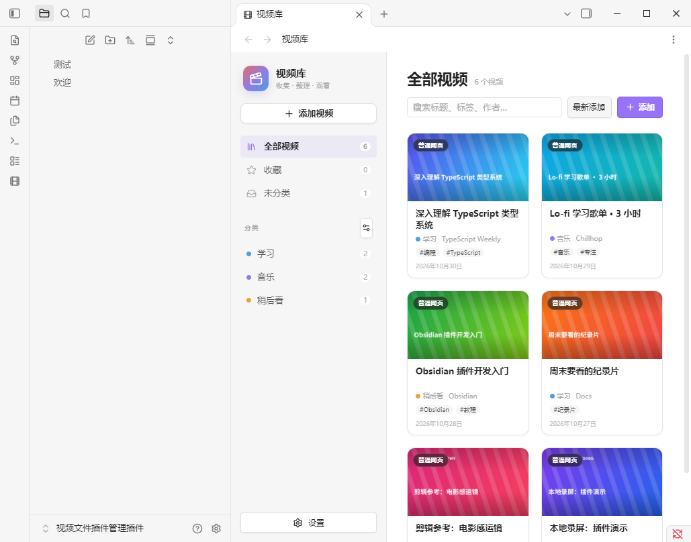

# 视频库 / Video Library

一个给 Obsidian 用的视频链接收藏插件：把 B 站、YouTube、Vimeo、视频直链或本地视频收进一个带封面的网格里，用自定义分类、标签、收藏和搜索来整理。



> 当前版本：`0.1.0`  
> 已在 Obsidian `1.14.5`（Windows 桌面版）实际测试通过。  
> 插件类型：仅桌面端。

---

## 已经实现的功能

- **视频链接管理**
  - B 站：`BV` 号、`av` 号、分 P、`b23.tv` 短链、番剧/影视 `ep` / `ss` 链接
  - 直接粘贴 `BV17f4y1n7et`、`av170001`、`ep419527` 这样的视频号也可以
  - YouTube：`watch`、`youtu.be`、`Shorts`
  - Vimeo：普通链接和带私有 hash 的链接
  - MP4 / WebM / MOV 等视频直链
  - 普通网页链接（保存标题和封面，播放时打开浏览器）
- **自动获取标题、作者、时长和封面**
- **封面可替换**
  - 自动抓取
  - 用截图软件截图后，在弹窗里按 `Ctrl+V`（Mac 为 `Cmd+V`）直接粘贴
  - 图片 URL
  - 仓库内的本地图片
  - 拖动进度条，从本地/直链视频里选择任意一帧
- **自定义分类**
  - 新建、重命名、删除
  - 自定义颜色
  - 删除分类时，视频自动移到“未分类”，不会删除视频
- **本地视频**
  - 选择仓库内的视频文件
  - 内嵌播放
  - 保存后自动从视频中截取封面
- **浏览与整理**
  - 封面网格、卡片大小切换
  - 标题 / 标签 / 作者 / 备注搜索
  - 收藏
  - 按添加时间、标题排序
  - 右键菜单：播放、编辑、打开原网页、复制链接、删除
  - 中英双语界面，可跟随 Obsidian 语言
- **数据持久化**
  - 视频、分类、设置保存在插件的 `data.json`
  - 封面保存在插件目录的 `covers/` 下，可随插件目录一起备份

---

## 在 Obsidian 里使用

1. 启动 Obsidian，打开测试仓库 `视频文件插件管理插件`。
2. 左侧栏点击胶片图标，或按 `Ctrl+P` 搜索“打开视频库”。
3. 点击“添加视频”，粘贴链接。
   - 链接粘贴后会自动识别标题和封面。
   - 识别失败也可以手动填写标题、图片链接或选择本地图片。
4. 选择分类；没有分类就点“新建分类”。
5. 保存后，卡片会出现在网格里。点击卡片播放，悬停卡片可编辑。
6. 左侧“管理分类”可以重命名、删除、换颜色。

> 本地视频必须先在 Obsidian 仓库里。把视频文件拖进仓库后，在“本地视频”页签点“选择仓库中的视频”。插件只记录文件路径，不会复制视频，也不会因为删除卡片而删除原文件。

---

## 安装 / 开发

### 环境

- Node.js 18 或更高（当前机器是 v24）
- npm
- Obsidian 桌面版

### 安装依赖并构建

```powershell
cd "G:\AIdeepseek ha\视频文件管理插件\video-library-plugin"
npm install
npm run build
```

构建会生成：

- `main.js`
- `styles.css`
- `manifest.json`
- `versions.json`

### 配置测试库

复制 `deploy.config.example.json` 为 `deploy.config.json`，把 `vault` 改成你的 Obsidian 仓库路径：

```json
{
  "vault": "G:\\AIdeepseek ha\\视频文件管理插件\\视频文件插件管理插件",
  "pluginId": "video-library"
}
```

然后运行：

```powershell
npm run dev
```

`npm run dev` 会监听源码变化，自动构建，并把产物复制到：

```text
<你的仓库>\.obsidian\plugins\video-library\
```

改完代码后，在 Obsidian 里按 `Ctrl+R` 重新加载，或到“设置 → 第三方插件”里关闭再启用插件。

### 当前电脑的特殊安装方式

这台电脑的 DSH 工作区有完整性级别限制，不能直接往 Obsidian 仓库里复制文件，所以当前使用 **目录链接**：

```text
G:\AIdeepseek ha\视频文件管理插件\视频文件插件管理插件\.obsidian\plugins\video-library
    -> G:\AIdeepseek ha\视频文件管理插件\video-library-plugin
```

Obsidian 会把链接当成普通插件目录；`npm run build` 检测到链接指向源码目录时，会跳过复制。

如果以后链接丢了，可以用管理员或普通 PowerShell 重新创建：

```powershell
Remove-Item "G:\AIdeepseek ha\视频文件管理插件\视频文件插件管理插件\.obsidian\plugins\video-library" -Force
cmd /c mklink /J "G:\AIdeepseek ha\视频文件管理插件\视频文件插件管理插件\.obsidian\plugins\video-library" "G:\AIdeepseek ha\视频文件管理插件\video-library-plugin"
```

普通用户如果不想用链接，直接按上一节配置 `deploy.config.json`，让构建脚本复制文件即可。

### 测试

```powershell
npm test
```

目前包含链接解析的单元测试：

- YouTube 各种链接
- B 站 BV / av / 分 P / b23 短链
- Vimeo 私有 hash
- 视频直链和普通网页
- 链接规范化与嵌入地址生成

---

## 数据与备份

插件数据在：

```text
<仓库>\.obsidian\plugins\video-library\data.json
<仓库>\.obsidian\plugins\video-library\covers\
```

- `data.json`：视频信息、分类、设置。
- `covers/`：下载或截取的封面图片。

备份整个 `video-library` 插件文件夹，就能保留视频库。删除卡片只会删除库里的记录和对应封面，不会删除原网页或本地视频文件。

---

## 已知限制

- B 站 / YouTube 的接口可能受网络、登录状态、地区或反爬限制。识别失败时，标题和封面都可以手动填写。
- 普通网页通常不允许在 Obsidian 内嵌播放，插件会提供“打开原网页”。
- 本地视频必须位于当前 Obsidian 仓库内。
- B 站播放器可能提示登录或限制清晰度，这是 B 站播放器本身的行为。
- 仅支持桌面端，不支持 Obsidian 手机端。
- 暂不支持批量导入、拖拽排序、播放列表、时间轴笔记。

---

## 版本管理

发布新版本时：

1. 修改 `package.json`、`manifest.json` 里的版本号。
2. 在 `versions.json` 增加 `"新版本": "最低 Obsidian 版本"`。
3. 运行 `npm test` 和 `npm run build`。
4. 提交并打标签：

```powershell
git add .
git commit -m "release: 0.1.0"
git tag 0.1.0
git push
git push --tags
```

GitHub Release 建议附上这三个文件，方便直接安装：

- `main.js`
- `manifest.json`
- `styles.css`

---

## English

Video Library is an Obsidian desktop plugin for collecting video links with automatic covers and user-defined categories.

- Supports Bilibili, YouTube, Vimeo, direct video URLs, generic web pages and local videos inside the vault.
- Fetches title, author, duration and cover automatically; every cover can be replaced with an image URL, a local image, or a frame captured from a local video.
- Custom categories with colors, tags, favorites, search, sorting, and a built-in player.
- Bilingual UI (Chinese / English), following Obsidian's language by default.

### Development

```powershell
npm install
npm run build   # production build
npm run dev     # watch + deploy to the vault configured in deploy.config.json
npm test
```

The plugin data lives in `.obsidian/plugins/video-library/data.json`, and covers live in its `covers/` folder.

---

## License

MIT
