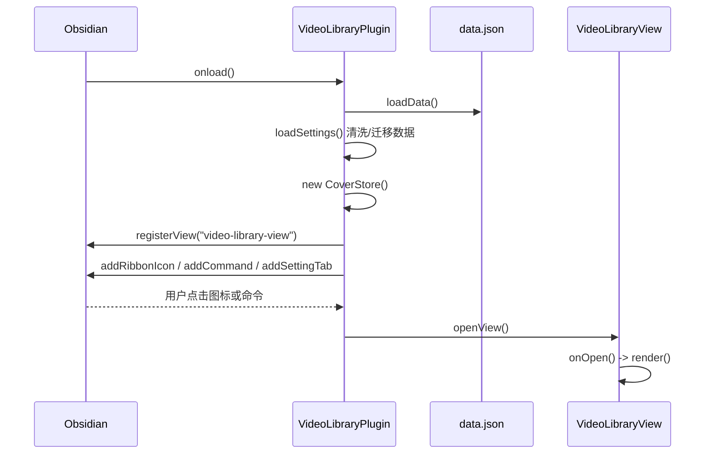
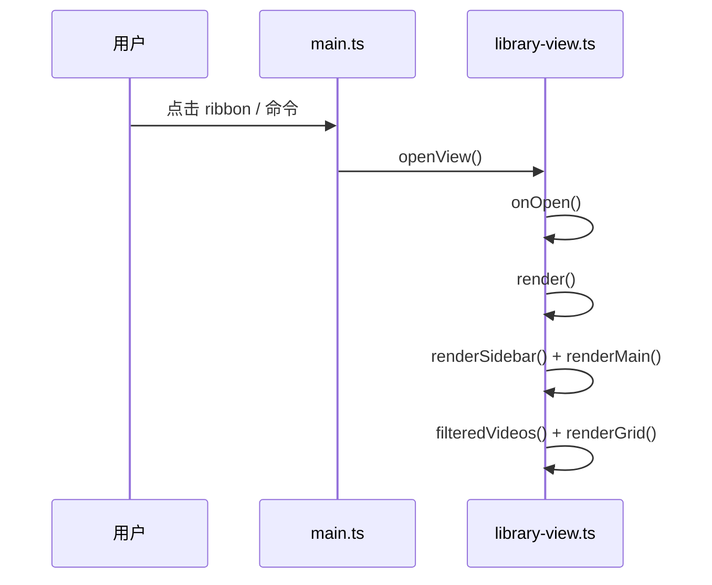
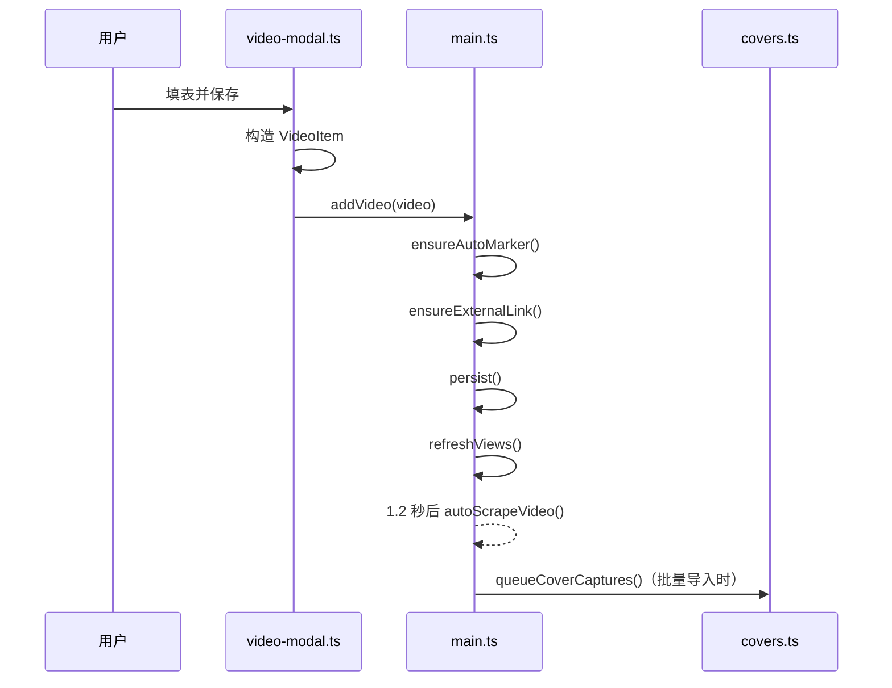
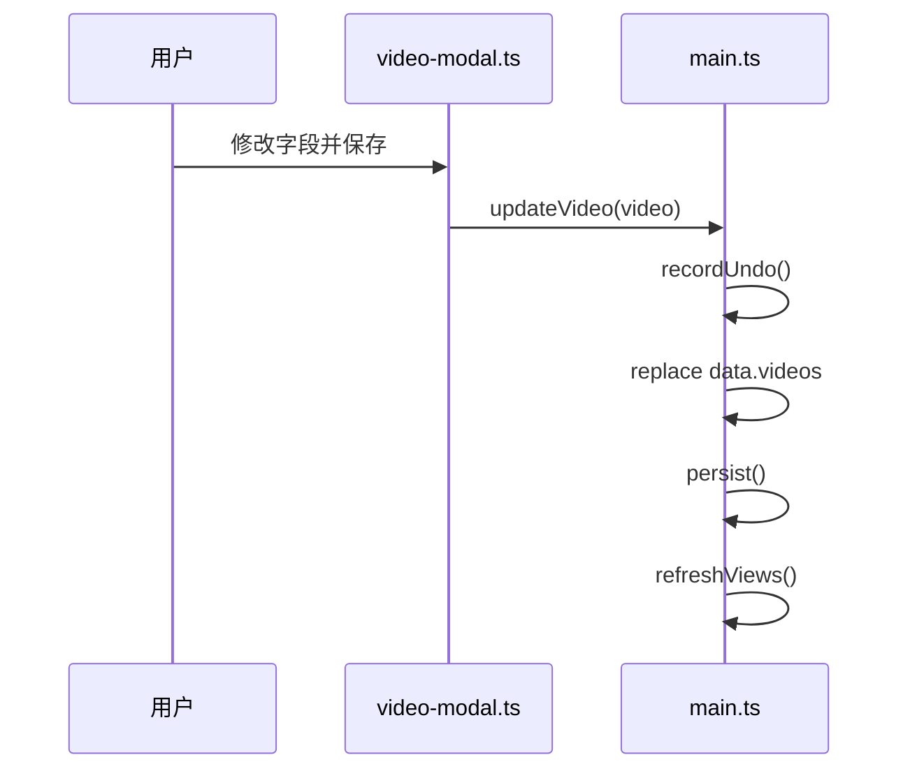
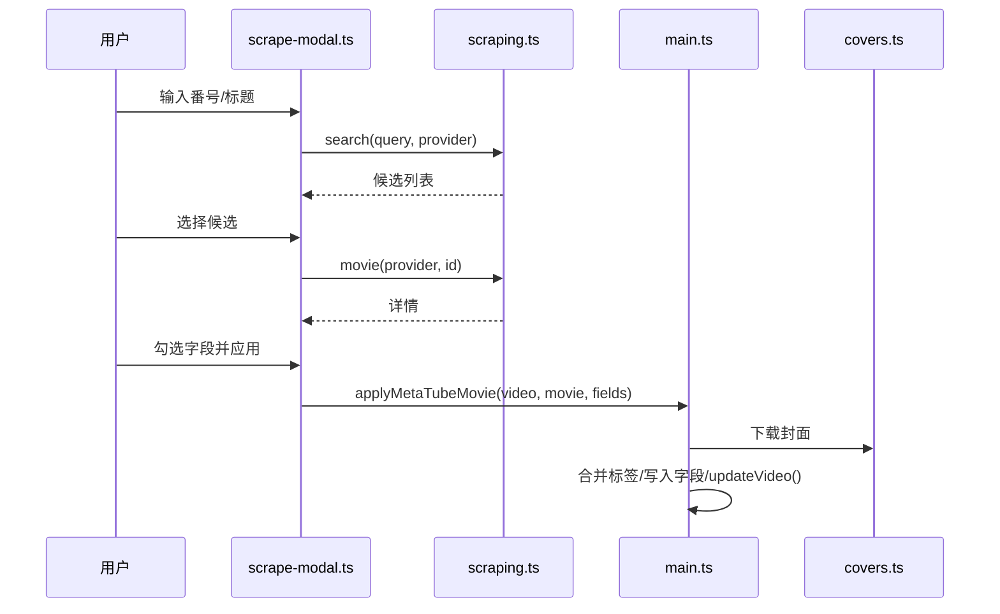
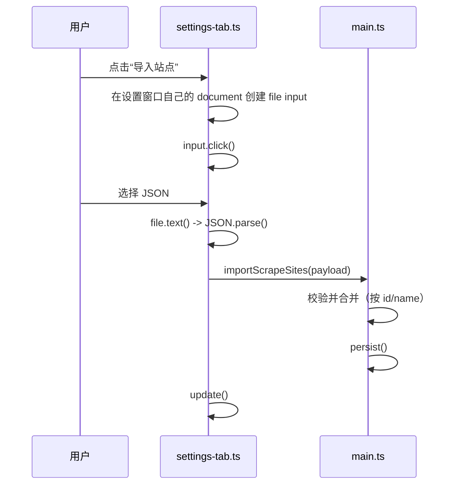

# 视频库插件：架构、代码地图与修改指南

> 适用版本：`0.9.0`
> 适用对象：想修改插件，但不想先学完整个 Obsidian 插件体系的人。
> 配套文件：`AI技术交接报告.skill.md`（给其他 AI / 新维护者的速查交接报告）。

---

## 0. 先看这里：五分钟建立整体印象

这个插件只做一件事：

> 在 Obsidian 里维护一个“视频库”，把视频链接或本地视频保存成卡片，并负责封面、分类、文件夹、标签、播放、刮削和设置。

它不是单独的网页，也不是单独的程序，而是 **Obsidian 桌面版的一个插件**。Obsidian 负责提供窗口、文件系统、设置面板、弹窗、网络请求和插件生命周期；插件负责视频库自己的数据与界面。

可以把它想成四层：

```text
┌─────────────────────────────────────────────────────────┐
│ 1. Obsidian 宿主                                        │
│    窗口 / 文件 / 设置面板 / Modal / requestUrl / 插件加载 │
└───────────────────────────┬─────────────────────────────┘
                            │ 调用
┌───────────────────────────▼─────────────────────────────┐
│ 2. 插件核心 main.ts                                     │
│    数据、增删改、持久化、撤销、刮削调度、MetaTube 进程     │
└───────────────┬───────────────────────────┬─────────────┘
                │ 读写数据                   │ 打开界面
┌───────────────▼──────────────┐  ┌─────────▼─────────────┐
│ 3. 数据与工具                 │  │ 4. 界面层 ui/          │
│ types / i18n / providers      │  │ 视图、弹窗、播放器、设置 │
│ metadata / covers / scraping  │  │ 只负责显示与收集输入     │
└──────────────────────────────┘  └───────────────────────┘
```

最重要的原则：

1. **界面不直接写 `data.json`**。界面调用 `main.ts` 的方法，由 `main.ts` 统一修改数据并保存。
2. **所有用户能看到的文字都走 `i18n.ts`**，不要直接在界面里写死中文或英文。
3. **每次修改数据后要 `persist()`**；需要刷新视频库界面时再调用 `refreshViews()`。
4. **`main.js` 是构建产物，不要手改**。要改 `src/`，然后重新构建。
5. **`data.json` 是用户数据，不要提交到 Git**。

---

## 0.1 当前开发状态（2026-11-04）

```text
版本：0.9.0
GitHub：https://github.com/hotdog-box/obsidian-video-library
分支：main
最新功能提交：20fbdc5 fix: preserve tag search and include folder videos
文档更新提交：见最新 git log
测试：npm run build ✅ / npm test ✅ 9/9
```

最近这一轮主要改了：

- 播放器：清晰度、倍速、空格/方向键、拖动、最大化、滚动、底部固定栏。
- B 站：登录、原生 DASH、清晰度、同步音轨、多 P 选集。
- 笔记：自动截图封面、Markdown 总结、内联多图、节点收起、总结折叠、节点树。
- 笔记分组：`NoteSection`，分组 `##`、卡片 `###`，可拖入/拖出。
- 整篇笔记回收：文件夹 + MD + 附件整体移动、还原、彻底删除。
- 悬停预览：笔记节点 2 秒片段、总时长 10 秒；B 站/网盘在线预览。
- 回收站：按视频分组、搜索、多选、截图时间。
- 标签：保留原搜索/多标签逻辑，标签筛选跨文件夹，匹配视频直接显示在全部视频区域。
- 侧边栏“视频笔记管理”、卡片“打开笔记”、关闭笔记刷新管理页。

**已知未完成：**

- 百度/夸克文件列表 API、选文件/文件夹自动填直链。
- B 站番剧 ep 列表选集（多 P 已做）。
- YouTube/Vimeo iframe 悬停预览。
- `notesGrouping = flat` 模式下的整篇笔记文件夹回收。

**明天继续时的最小命令：**

```powershell
cd 'G:\AIdeepseek ha\视频文件管理插件\video-library-plugin'
npm install
npm run build
npm test
```

插件测试库：

```text
G:\AIdeepseek ha\视频文件管理插件\视频文件插件管理插件
```

主库：

```text
I:\各种老师
```

---

## 1. 项目目录与文件地图

### 1.1 根目录

```text
video-library-plugin/
├─ manifest.json                 Obsidian 插件清单（ID、版本、最低 Obsidian 版本）
├─ versions.json                 版本与最低 Obsidian 版本的对应表
├─ package.json                  npm 脚本与开发依赖
├─ tsconfig.json                 TypeScript 编译配置
├─ build.mjs                     Rollup 构建脚本，负责生成 main.js/styles.css 并可自动部署
├─ deploy.config.json            本地部署配置（不提交 Git）
├─ README.md                     面向用户的安装、使用、刮削说明
├─ CHANGELOG.md                  版本更新记录
├─ LICENSE                       MIT 协议
├─ main.js                       构建产物：插件真正加载的代码（不提交 Git）
├─ styles.css                    构建产物：插件样式（不提交 Git）
├─ data.json                     测试库的插件数据（不提交 Git）
├─ covers/                       测试库的封面缓存（不提交 Git）
├─ external-links/               外部视频的播放缓存（不提交 Git）
├─ screenshots/                  本地截图（不提交 Git）
├─ 刮削站点导入代码/              本地站点模板（不提交 Git）
└─ src/                          所有源代码
```

> 重要：这个项目的测试库把 `.obsidian/plugins/video-library` 链接到了源码目录，所以根目录的 `data.json`、`covers/`、`external-links/` 其实就是测试库的数据。它们都被 `.gitignore` 忽略。

### 1.2 `src/` 源文件

| 文件 | 一句话作用 | 什么时候改它 |
|---|---|---|
| `src/main.ts` | 插件主类。持有全部数据，提供所有业务方法 | 加数据操作、加命令、改刮削流程、改持久化 |
| `src/types.ts` | 数据类型、默认值、默认标记、颜色、工具函数 | 加字段、加设置项、改数据结构 |
| `src/i18n.ts` | 中英文词典、当前语言、`t()` 翻译函数 | 加任何用户可见文字 |
| `src/providers.ts` | 识别 B 站/YouTube/Vimeo/直链/网页，生成嵌入地址 | 加视频来源、改 URL 识别 |
| `src/metadata.ts` | 抓网页标题/封面，调用 B 站、YouTube、Vimeo 接口 | 改自动获取标题/作者/封面 |
| `src/covers.ts` | 封面文件读写、下载、视频截帧、预览 URL | 改封面存储、截帧、图片下载 |
| `src/scraping.ts` | MetaTube HTTP 客户端、搜索词生成、日期清洗 | 改刮削协议、超时、搜索规则 |
| `src/notes.ts` | 笔记文件、时间节点、截图、回收站的读写 | 改笔记格式、节点解析、附件路径 |
| `src/stream-server.ts` | 本地 HTTP 流代理，转发带鉴权的视频 Range 请求 | 改流代理、CORS、重定向 |
| `src/bilibili.ts` | B 站扫码登录、Cookie、DASH 播放地址 | 改 B 站登录或清晰度选择 |
| `src/cloud.ts` | 网盘凭据头、连接测试 | 加网盘 API 适配 |
| `src/cloud-login-window.ts` | 用 Electron 登录窗口读取百度/夸克 Cookie | 改网盘登录流程 |
| `src/updates.ts` | GitHub Release 检查与版本比较 | 改更新逻辑 |
| `src/styles.css` | 全部样式 | 改外观、间距、按钮、动画 |
| `src/ui/library-view.ts` | 视频库主视图：侧边栏、首页、网格/列表、选择、拖拽 | 改主界面、搜索、排序、右键菜单 |
| `src/ui/video-modal.ts` | 添加/编辑视频弹窗 | 改视频表单、封面、来源、预览设置 |
| `src/ui/player-modal.ts` | 可缩放播放器、详情、关联视频、快速编辑、时间节点标记 | 改播放器、详情面板、关联视频 |
| `src/ui/notes-panel.ts` | 播放器右侧笔记面板、节点树、总结折叠、节点收起、拖动排序 | 改笔记交互 |
| `src/ui/notes-view.ts` | 笔记管理视图：视频文件夹、节点卡片、封面、整篇笔记删除 | 改笔记管理界面 |
| `src/ui/notes-trash-modal.ts` | 笔记回收站：按视频分组、多选、整篇还原/删除 | 改回收站 |
| `src/ui/note-sections-modal.ts` | 笔记分组管理：新建、改名、分组总结、删除 | 改独立分组 |
| `src/ui/notes-floating-view.ts` | 悬浮笔记 popout 窗口 | 改悬浮笔记 |
| `src/ui/cloud-help-modal.ts` | 网盘直链帮助 | 改直链说明弹窗 |
| `src/ui/bilibili-login-modal.ts` | B 站二维码登录 | 改扫码登录 |
| `src/ui/cloud-login-modal.ts` | 网盘 Cookie/Token 登录 | 改网盘登录 |
| `src/ui/cloud-add-modal.ts` | 添加网盘视频地址 | 改网盘视频表单 |
| `src/ui/scrape-modal.ts` | 手动刮削弹窗：搜索、选候选、勾字段 | 改刮削交互 |
| `src/ui/settings-tab.ts` | 插件设置页 | 加设置项、改站点列表、改按钮 |
| `src/ui/marker-modal.ts` | 标记管理、标记编辑（链接标记/刮削站点） | 改标记/站点表单 |
| `src/ui/frame-modal.ts` | 从视频里选一帧当封面 | 改截帧选择器 |
| `src/ui/hover-preview.ts` | 鼠标悬停卡片时的静音预览 | 改悬停预览逻辑 |
| `src/ui/preview-config-modal.ts` | 配置悬停预览的时长和片段 | 改预览片段编辑器 |
| `src/ui/category-modal.ts` | 分类管理和分类编辑 | 改分类弹窗 |
| `src/ui/folder-cover-modal.ts` | 文件夹封面选择 | 改文件夹封面 |
| `src/ui/batch-rename-modal.ts` | 批量查找替换重命名 | 改批量重命名 |
| `src/ui/tag-manager-modal.ts` | 标签管理 | 改标签管理 |
| `src/ui/move-modal.ts` | “移动到文件夹”搜索选择 | 改移动弹窗 |
| `src/ui/common.ts` | 公共弹窗、图标按钮、格式化、文件选择 | 加通用小组件 |

### 1.3 不要直接改的文件

- `main.js`：由 `npm run build` 生成。
- `styles.css`（根目录）：由 `src/styles.css` 复制生成。
- `data.json`：用户数据。
- `covers/`、`external-links/`：用户缓存。
- `刮削站点导入代码/`：本地模板，GitHub 版本不附带。

---

## 2. 启动时发生了什么



对应代码：

- `main.ts` 的 `onload()`：加载数据、注册视图、 ribbon 图标、命令、设置页。
- `loadSettings()`：不是简单 `loadData()`，它会做大量“清洗”：
  - 补默认值；
  - 修复失效的分类/文件夹/标记 ID；
  - 把字符串形式的演员拆成数组；
  - 迁移旧标签；
  - 修复外部视频的播放链接；
  - 必要时写回 `data.json`。
- `VideoLibraryView.onOpen()`：创建根 DOM，绑定键盘/拖拽事件，然后 `refresh()`。
- `VideoLibraryView.refresh()`：重新渲染整个视图。

### 2.1 为什么要有 `loadSettings()` 的清洗

用户可能：

- 手动改过 `data.json`；
- 从旧版本升级；
- 删除了分类/文件夹/标记；
- 把视频文件移动了位置。

如果直接信任文件内容，界面会出现“引用了不存在的分类”“视频标记指向已删除的站点”等问题。`loadSettings()` 在启动时把这些引用修好，保证运行期数据是自洽的。

> 加新字段时，最好在 `loadSettings()` 里也做一次类型/默认值清洗，避免旧数据让界面报错。

---

## 3. 数据模型

所有持久化数据都在 `PluginData` 里（`src/types.ts`）：

```ts
interface PluginData {
  version: number;
  videos: VideoItem[];
  categories: Category[];
  folders: Folder[];
  tags: Tag[];
  markers: Marker[];
  settings: PluginSettings;
}
```

当前 `DATA_VERSION = 6`。

### 3.1 `VideoItem`

一条视频记录。重点字段：

| 字段 | 说明 |
|---|---|
| `id` | 唯一 ID，`uid("vid")` 生成 |
| `url` | 原始链接；本地视频为空字符串 |
| `provider` | `bilibili` / `youtube` / `vimeo` / `direct` / `web` / `local` |
| `videoId` | B 站 BV/av、YouTube ID、Vimeo ID |
| `title` | 标题 |
| `author` | 作者/UP 主 |
| `studio` | 厂商/片商 |
| `series` | 系列 |
| `performers` | 演员数组 |
| `description` | 简介 |
| `releaseDate` | 上架日期，字符串 `YYYY-MM-DD` |
| `markers` | 标记 ID 数组（链接标记 + 刮削站点标记） |
| `externalId` | 刮削来源的影片 ID |
| `metadataSource` | 例如 `metatube:JavBus` |
| `scrapedAt` | 上次刮削时间戳 |
| `categoryId` | 分类 ID；无效时归到 `uncategorized` |
| `folderId` | 文件夹 ID；可以为空 |
| `tags` | 标签名数组（不是标签 ID） |
| `notes` | 用户备注，刮削永远不覆盖 |
| `coverPath` | 插件 `covers/` 下的文件名 |
| `thumbnailUrl` | 远程封面地址（不一定下载） |
| `localPath` | 本地视频绝对路径 |
| `localExternal` | 是否是仓库外的本地视频 |
| `localLinkPath` | `external-links/` 下的播放缓存路径 |
| `duration` | 秒 |
| `preview` | 悬停预览配置：总时长 + 片段数组 |
| `favorite` / `pinned` / `pinnedAt` | 收藏、置顶 |
| `sortOrder` | 手动排序 |
| `lastPlayedAt` | 最近播放时间 |
| `createdAt` / `updatedAt` | 时间戳 |

### 3.2 `Category`、`Folder`、`Tag`

- `Category`：扁平分类，只有 `id/name/color/createdAt`。
- `Folder`：树形文件夹，`parentId` 指向父文件夹；`coverPath` 是文件夹封面。
- `Tag`：标签库，`name` 是唯一显示名；视频里存的是标签名。

### 3.3 `Marker`

`Marker` 同时表示两种东西：

| `kind` | 用途 |
|---|---|
| `link` | 链接标记，例如 B 站、YouTube；可绑定 `autoProvider` |
| `site` | 刮削站点，例如 JavBus、Jav321；可绑定 `metatubeProvider` |

关键字段：

- `enabled`：站点是否启用。
- `metatubeProvider`：对应 MetaTube 的来源名，**大小写敏感**。
- `capabilities`：`有码` / `无码`，只用于界面展示。
- `url`：站点主页，仅展示/记录用。
- `description`：站点说明。
- `sortOrder`：站点回退顺序。

> GitHub 版本默认只有 B 站和 YouTube 两个链接标记，**不附带任何刮削站点**。这是刻意设计，避免把具体站点写死进插件。

### 3.4 `PluginSettings`

| 设置 | 说明 |
|---|---|
| `language` | `auto` / `zh` / `en` |
| `sort` | 排序方式 |
| `cardSize` | 卡片大小 |
| `viewMode` | 网格/列表 |
| `previewMuted` / `previewVolume` | 悬停预览音频 |
| `tagMatchMode` | 标签“任一/全部” |
| `pinnedCollapsed` | 置顶区是否折叠 |
| `metatubeUrl` | MetaTube 地址 |
| `metatubeToken` | MetaTube Token |
| `metatubeServerPath` | `metatube-server.exe` 路径 |
| `scrapeAuto` | 添加链接后是否自动刮削 |
| `relatedEnabled` | 播放页是否显示关联视频 |

### 3.5 数据放在哪里

- 数据：`<vault>/.obsidian/plugins/video-library/data.json`
- 封面：`<vault>/.obsidian/plugins/video-library/covers/`
- 外部视频播放缓存：`<vault>/.obsidian/plugins/video-library/external-links/`

备份插件目录，就备份了视频库的全部数据。

---

## 4. 核心文件详解

### 4.1 `src/main.ts`：插件主类

`VideoLibraryPlugin extends Plugin`，是整个插件的“大脑”。

它负责：

1. **生命周期**：`onload()`、`onunload()`。
2. **数据**：`data` 字段、`loadSettings()`、`persist()`。
3. **撤销**：`recordUndo()`、`undo()`、`canUndo()`。
4. **视图刷新**：`refreshViews()`。
5. **分类/文件夹/标签/标记的增删改**。
6. **视频增删改、排序、收藏、置顶、播放记录**。
7. **本地/外部视频导入、播放缓存、删除**。
8. **封面截取队列**。
9. **MetaTube 刮削**：连接测试、启动/停止服务、手动/自动刮削、写回字段。
10. **打开插件数据/封面文件夹**。

常用方法（改代码时最常调用）：

| 方法 | 作用 |
|---|---|
| `persist()` | 把 `this.data` 写入 `data.json` |
| `refreshViews()` | 刷新所有已打开的视频库视图 |
| `recordUndo()` | 在修改前保存一份完整数据快照 |
| `undo()` | 恢复上一份快照 |
| `addVideo()` | 添加视频、补自动标记、建立外部缓存、保存、刷新、安排自动刮削 |
| `updateVideo()` | 更新视频并保存 |
| `deleteVideo()` / `deleteVideos()` | 删除视频 |
| `updateVideos()` | 批量修改 |
| `saveMarker()` / `deleteMarker()` | 保存/删除标记或站点 |
| `importScrapeSites()` | 导入站点 JSON |
| `applyMetaTubeMovie()` | 把 MetaTube 详情写入视频 |
| `autoScrapeVideo()` | 自动刮削 |
| `queueCoverCaptures()` | 后台批量截封面 |

> 新增一个“会改数据”的方法时，记得在方法开头调用 `recordUndo()`，修改后 `await this.persist()`，需要界面更新时再 `refreshViews()`。

### 4.2 `src/types.ts`：数据契约

这里定义：

- 所有实体接口；
- `DATA_VERSION`；
- `DEFAULT_MARKERS`；
- `TAG_COLORS`；
- `DEFAULT_SETTINGS`；
- `createDefaultData()`；
- `uid()`；
- 预览配置的清洗函数。

它是“数据长什么样”的唯一权威。改字段时，先改这里。

### 4.3 `src/i18n.ts`：翻译

结构：

```ts
const en = { "settings.title": "Video Library", ... };
const zh = { "settings.title": "视频库", ... };
export type MessageKey = keyof typeof en;
export function t(key: MessageKey, params?: Record<string, string | number>): string;
export function setLanguage(setting: LanguageSetting): void;
```

规则：

- 新增文字时，**英文和中文都要加**，key 保持一致。
- 不要在 `ui/` 里直接写用户可见的中文/英文。
- 参数用 `{name}` 占位，例如 `t("scrape.importedSites", { count })`。
- `providerName()` 也在这里，用于显示来源名称。

### 4.4 `src/providers.ts`：链接识别

职责：

- `normalizeUrlInput()`：把 `BV...`、`av...`、`ep...`、`www...` 补成完整 URL。
- `parseVideoUrl()`：判断来源，提取 `videoId`、`page`、`epId`、`seasonId`、`vimeoHash`，生成 canonical URL 和嵌入地址。
- `buildEmbedUrl()` / `buildBilibiliEmbed()`：生成 iframe 地址。
- `fallbackTitleFromUrl()`：从 URL 猜标题。
- `defaultCoverFor()`：来源默认封面标识。

改“支持新网站”通常从这里开始。

### 4.5 `src/metadata.ts`：自动获取标题/封面

职责：

- 用 `requestUrl` 抓网页；
- 解析 `<meta>`、`<title>`、`<link rel=canonical>`；
- B 站：短链解析、`/x/web-interface/view`、番剧 `pgc/view/web/season`；
- YouTube：oEmbed，失败再抓页面；
- Vimeo：oEmbed；
- 直链：只用文件名；
- 普通网页：抓 OG 信息。

它只负责“取回元数据”，不负责保存。保存由 `video-modal.ts` 调 `plugin.addVideo/updateVideo` 完成。

### 4.6 `src/covers.ts`：封面

`CoverStore` 负责：

- 确保 `covers/` 存在；
- 读取/保存/删除封面文件；
- 把仓库内图片复制成封面；
- 下载远程图片（可带 Referer）；
- 把 ArrayBuffer 变成可预览的 blob URL；
- 从 `<video>` 元素截帧；
- 用隐藏 `<video>` 从 URL 截帧；
- 释放 blob URL。

封面文件只存文件名到 `video.coverPath`，不存绝对路径，方便整个插件目录迁移。

### 4.7 `src/scraping.ts`：MetaTube 客户端

`MetaTubeClient` 只做三件事：

```ts
search(query, provider?)  // GET /v1/movies/search
movie(provider, id)       // GET /v1/movies/{provider}/{id}
providers()               // GET /v1/providers
```

关键设计：

- 超时 **90 秒**。全部来源搜索可能很慢，不能再用 8 秒。
- 404 视为“没有结果”，返回 `[]`，不抛错。
- 指定 `provider` 时 `fallback=false`；不指定时 `fallback=true`。
- `provider` 大小写敏感，必须和 MetaTube 返回的名称一致。
- `scrapeQueries()` 先提取番号（如 `FH-059`），再回退到清洗后的标题。
- `normalizeDate()` 只保留 `YYYY-MM-DD`。

### 4.8 `src/ui/library-view.ts`：主视图

这是最大的 UI 文件，负责：

- 侧边栏：首页、全部视频、收藏、未分类、分类、文件夹树、标签筛选；
- 顶部工具栏：搜索、添加、视图切换、排序、撤销；
- 首页：轮播、置顶、最近添加、收藏、本地视频、分类行；
- 网格/列表渲染；
- 选择逻辑：单击选中、双击打开、Ctrl/Cmd 切换、Shift 连选、框选；
- 拖拽：卡片到文件夹、文件夹到文件夹、拖到面包屑/文件夹树、手动排序；
- 右键菜单；
- 批量操作栏；
- 搜索和筛选。

搜索规则在 `filteredVideos()`：

- 有搜索词时，**忽略当前分类和文件夹**，搜索整个库；
- 搜索范围：标题、作者、URL、备注、标签、标记名、分类名；
- 没有搜索词时，才按分类/文件夹/收藏过滤。

### 4.9 `src/ui/video-modal.ts`：添加/编辑视频

负责：

- URL / 本地文件两种来源；
- 自动识别来源、标题、作者、封面、时长；
- 分类、文件夹、标签、标记；
- 厂商、系列、演员、上架日期、简介、备注；
- 封面：自动抓取、URL、仓库图片、粘贴、截帧；
- 悬停预览配置；
- 保存时构造 `VideoItem`，调用 `plugin.addVideo()` 或 `plugin.updateVideo()`。

### 4.10 `src/ui/player-modal.ts`：播放器

负责：

- 嵌入播放器（B 站/YouTube/Vimeo）或本地 `<video>`；
- 自定义进度条、缓冲、音量、全屏、播放/暂停；
- 进度条悬停帧预览；
- 预览片段菱形节点；
- 详情面板；
- 标签/系列/演员可点击，显示关联视频；
- 快速编辑标签和备注；
- 刮削按钮。

关联视频规则：标签、系列、演员任一精确匹配；按时间倒序；默认 10 个，可展开全部。

### 4.11 `src/ui/scrape-modal.ts`

流程：

1. 选择来源（默认全部来源）；
2. 输入番号/标题；
3. 搜索；
4. 选择候选；
5. 读取详情；
6. 勾选要写入的字段；
7. 调用 `plugin.applyMetaTubeMovie()`。

### 4.12 `src/ui/settings-tab.ts`

使用 Obsidian 的声明式设置 API：

```ts
getSettingDefinitions(): SettingDefinitionItem[]
```

普通设置项用 `control`（text/toggle/dropdown）；需要自定义界面的用 `render`。

本文件还负责：

- 刮削站点列表：启用/停用、改 URL、测试、上移/下移、删除；
- 自定义添加站点；
- 导入站点 JSON；
- 导出站点 JSON；
- 测试已启用站点；
- MetaTube 程序路径、启动/停止、地址、Token、自动刮削、连接测试；
- 打开数据/封面文件夹；
- 关联视频开关。

> 设置页可能在独立弹窗（popout）里。访问它自己的 DOM 要用 `this.containerEl.ownerDocument`，不要用全局 `document`。

### 4.13 `src/ui/marker-modal.ts`

- `MarkerManagerModal`：管理所有标记。
- `MarkerEditModal`：新建/编辑标记。
  - `kind = "link"`：绑定自动来源。
  - `kind = "site"`：填写站点 URL、MetaTube 来源、能力、说明、启用状态。
  - 站点能力只保留“有码/无码”。

### 4.14 其他 UI

- `frame-modal.ts`：播放视频、拖动进度、选一帧。
- `hover-preview.ts`：卡片悬停预览，按片段循环，带音量控制。
- `preview-config-modal.ts`：设置预览总时长和多个片段。
- `category-modal.ts`：分类管理/编辑。
- `folder-cover-modal.ts`：文件夹封面。
- `batch-rename-modal.ts`：批量查找替换。
- `tag-manager-modal.ts`：标签管理。
- `move-modal.ts`：搜索文件夹并移动。
- `common.ts`：`ConfirmModal`、`TextPromptModal`、`iconButton`、`pickVaultFile`、格式化函数。

---

## 5. 关键交互流程

### 5.1 打开视频库



### 5.2 添加视频



### 5.3 编辑视频



### 5.4 手动刮削



### 5.5 自动刮削

- 默认关闭（`scrapeAuto = false`）。
- 添加链接后延迟约 1.2 秒触发。
- 先按视频绑定站点，再按启用站点顺序回退。
- 每个查询词、每个站点搜索。
- **只有恰好 1 个候选时才写入**；多个候选会提示手动刮削。
- 不会覆盖备注，标签只合并。

### 5.6 站点导入/导出



导出时生成：

```json
{
  "version": 1,
  "type": "video-library-scrape-sites",
  "generatedAt": "2026-11-02",
  "sites": [
    {
      "id": "site_javbus",
      "name": "JavBus",
      "kind": "site",
      "enabled": true,
      "metatubeProvider": "JavBus",
      "capabilities": ["有码", "无码"],
      "url": "https://www.javbus.com",
      "sortOrder": 1
    }
  ]
}
```

### 5.7 撤销

- `recordUndo()` 在修改前把整个 `PluginData` 深拷贝进 `undoStack`。
- 最多 30 份。
- `undo()` 弹出最后一份，覆盖 `this.data`，保存并刷新。
- **只恢复数据，不恢复已删除的封面/本地文件**。

### 5.8 刷新机制

- `persist()` 只写文件，不碰界面。
- `refreshViews()` 遍历所有 `video-library-view` 的 leaf，调用 `view.refresh()`。
- 设置页不是 view，改完设置后要调用 `this.update()` 重新渲染设置页。

---

## 6. 样式与交互约定

### 6.1 CSS 命名

- 统一前缀 `vl-`。
- 组件名用短横线：`.vl-settings-site`、`.vl-player-related`。
- 状态类：`.is-disabled`、`.is-selected`、`.is-error`、`.is-primary`。
- 尽量不要改 Obsidian 全局类；只改 `.vl-*` 和必要的 `.mod-settings` 范围。

### 6.2 点击反馈

当前设计：

- 只对 **按钮** 做按压缩放：`transform: scale(0.9)`。
- 不再对 `.setting-item` 整行做 `:active`，否则点行内任意按钮都会让整行/整页抖动。
- 设置页按钮统一用 `.vl-settings-action`、`.vl-settings-footer-btn`、`.vl-settings-site-action`。

新增按钮时：

1. 用 `createEl("button", { attr: { type: "button" } })`；
2. 加 `vl-` 类；
3. 需要图标时用 `setIcon(button, "icon-name")`；
4. 不要给父级 `.setting-item` 加 `:active` 动画。

### 6.3 图标

Obsidian 内置 Lucide 图标，直接：

```ts
setIcon(element, "folder-open");
```

常用：`plus`、`upload`、`download`、`play`、`square`、`globe-2`、`chevron-up`、`chevron-down`、`x`、`flask-conical`、`plug-zap`、`book-open`、`image`。

---

## 7. 小白修改指南

### 7.1 改一句界面文字

1. 在 `src/i18n.ts` 找到对应 key。
2. 同时改英文和中文。
3. `npm run build`。
4. 在 Obsidian 里禁用/启用插件，或重启 Obsidian。

不要只改中文：英文用户会看到旧文字；类型检查也可能因为 key 缺失报错。

### 7.2 加一个设置项

以“是否显示视频数量”为例：

1. `src/types.ts`
   - 在 `PluginSettings` 加 `showCount: boolean;`
   - 在 `DEFAULT_SETTINGS` 加 `showCount: true`
2. `src/main.ts` 的 `loadSettings()`
   - 加 `settings.showCount = settings.showCount !== false;`
3. `src/ui/settings-tab.ts`
   - 在 `getSettingDefinitions()` 加一个 `toggle`，`key: "showCount"`
   - 在 `getControlValue()` 返回它
   - 在 `setControlValue()` 保存它并 `persist()`
4. 使用它的界面读取 `this.plugin.data.settings.showCount`
5. `src/i18n.ts` 加中英文 key
6. 构建、测试

### 7.3 给视频加一个新字段

以“评分”为例：

1. `src/types.ts` 的 `VideoItem` 加 `rating?: number;`
2. `src/main.ts` 的 `loadSettings()` 清洗：
   ```ts
   rating: Number.isFinite(Number(video.rating)) ? Number(video.rating) : undefined,
   ```
3. `src/ui/video-modal.ts`
   - 加输入框字段
   - `populateFields()` 回填
   - `save()` 写入 `VideoItem`
4. `src/ui/player-modal.ts` 的 `renderDetails()` 显示
5. 如需搜索，在 `library-view.ts` 的 `filteredVideos()` 的 `haystack` 加进去
6. `src/i18n.ts` 加标签文字
7. 构建、测试旧数据

### 7.4 加一个按钮

1. 在对应 UI 文件里 `createEl("button")`。
2. 用 `setIcon` 加图标，文字走 `t()`。
3. 加 `vl-` 类，复用现有按钮样式。
4. 点击回调里调用 `main.ts` 的业务方法，不要直接改 `data`。
5. 如果会改数据，业务方法里要 `recordUndo()` + `persist()` + `refreshViews()`。

### 7.5 加一个新弹窗

1. 在 `src/ui/` 新建 `xxx-modal.ts`。
2. `export class XxxModal extends Modal`。
3. `onOpen()` 里创建 DOM；`onClose()` 里 `this.contentEl.empty()`。
4. 在调用处 `new XxxModal(this.app, ...).open()`。
5. 需要样式就在 `src/styles.css` 加 `.vl-xxx-modal`。
6. 不需要注册，Obsidian 的 Modal 直接 open 即可。

### 7.6 加一个视频来源

以“支持某个新网站”为例：

1. `src/types.ts` 的 `Provider` 加新值。
2. `src/providers.ts`
   - 加 host 判断；
   - 写 `parseXxx()`；
   - 在 `parseVideoUrl()` 里返回新 provider。
3. `src/metadata.ts`
   - 加 `fetchXxx()`；
   - 在 `fetchVideoMetadata()` 的 `switch` 里调用。
4. `src/i18n.ts` 的 `provider.*` 加显示名。
5. `src/ui/player-modal.ts` 的播放分支支持新来源（iframe 或 video）。
6. `src/ui/video-modal.ts` 的来源徽章/检测逻辑确认可用。
7. 测试：短链、分享链接、无 ID 链接、失效链接。

### 7.7 加一个刮削站点

**通常不需要改代码。**

1. 确认 MetaTube 已安装并启动。
2. 在 MetaTube 的 `/v1/providers` 里找到来源名（大小写敏感）。
3. 插件设置 → 刮削站点 → 自定义添加站点：
   - 名称
   - 站点 URL
   - MetaTube 来源（必须完全一致）
   - 有码/无码
   - 说明
4. 或导入 JSON 模板。

如果来源在 MetaTube 里不存在，测试会提示 `Provider “xxx” is not available`。

### 7.8 改样式

1. 只改 `src/styles.css`。
2. 用 `npm run build` 生成根目录 `styles.css`。
3. Obsidian 里重载插件。
4. 优先用 Obsidian CSS 变量：
   - `--background-primary`
   - `--background-secondary`
   - `--text-normal`
   - `--text-muted`
   - `--text-faint`
   - `--interactive-accent`
   - `--background-modifier-border`

不要写死颜色，否则深色/浅色主题会难看。

### 7.9 改数据结构 / 升级版本

如果只是加可选字段，通常不用改 `DATA_VERSION`；`loadSettings()` 补默认值即可。

如果做了不兼容的改法（例如把 `tags: string[]` 改成 `tagIds: string[]`），必须：

1. 提升 `DATA_VERSION`；
2. 在 `loadSettings()` 里根据旧版本做迁移；
3. 迁移后 `persist()`；
4. 在 CHANGELOG 里写清楚。

---

## 8. 构建、部署与调试

### 8.1 安装依赖

```bash
npm install
```

### 8.2 开发构建

```bash
npm run build
```

它做两件事：

1. `tsc --noEmit` 类型检查；
2. Rollup 打包 `src/main.ts` → `main.js`，复制 `src/styles.css` → `styles.css`。

### 8.3 监听构建

```bash
npm run dev
```

修改 `src/` 后自动重建。Obsidian 里仍需“禁用/启用插件”或重启才能加载新 `main.js`。

### 8.4 自动部署

`deploy.config.json`：

```json
{
  "vault": "I:\\你的仓库路径",
  "pluginId": "video-library"
}
```

`build.mjs` 在构建后会把：

- `main.js`
- `styles.css`
- `manifest.json`
- `versions.json`

复制到 `<vault>/.obsidian/plugins/video-library/`。

如果目标目录是指向源码的 junction/symlink，脚本会提示“linked to this source folder; nothing to copy”。

### 8.5 在 Obsidian 里重载

- 设置 → 第三方插件 → 关闭再打开 Video Library；
- 或命令面板执行“重新加载应用”（更彻底）；
- 或重启 Obsidian。

### 8.6 调试

- `Ctrl+Shift+I` 打开开发者工具。
- 看 Console 的 `video-library:` 前缀日志。
- 设置页可能在独立窗口：用 `app.setting.win.document` 检查它，而不是主窗口 `document`。
- 数据问题先备份 `data.json`，再改。

### 8.7 常见问题

| 现象 | 常见原因 | 处理 |
|---|---|---|
| 构建报 TypeScript 错 | 类型没补齐 / 参数不匹配 | 看 `tsc` 第一处错误，不要只看最后一行 |
| 改了代码没变化 | 没重载插件 / 构建到了别处 | `npm run build`，确认 `main.js` 时间，重载 |
| 设置页按钮点不动 | 用了主窗口 `document` | 用 `this.containerEl.ownerDocument` |
| 导入站点没反应 | file input 不在当前窗口 | 同文档创建 input，再 `click()` |
| 刮削超时 | 全部来源搜索很慢 | 已设 90 秒；优先指定来源 |
| 刮削 404 报错 | 旧代码把 404 当失败 | 现在 404 返回空结果 |
| 站点测试提示来源不存在 | `metatubeProvider` 大小写/名称不对 | 用 `/v1/providers` 的原始名称 |
| 封面不显示 | `coverPath` 失效 / 文件被删 | 重新抓取或重新选择封面 |
| 外部视频不能播放 | 源文件移动 / 缓存失效 | 重新选择文件，或让插件重建缓存 |

---

## 9. 设计取舍与已知限制

1. **仅桌面端**：依赖 Node/Electron 的文件选择、外部路径、进程启动。
2. **MetaTube 是外部服务**：插件不打包 MetaTube 代码，只通过 HTTP 调用；没有 MetaTube 时，普通视频库功能仍然可用。
3. **GitHub 版本不带站点**：避免把站点列表写死；站点由用户导入或手动添加。
4. **撤销不恢复文件**：只恢复 `data.json` 数据；已删除的封面/本地视频文件不会回来。
5. **关联视频是精确匹配**：标签、系列、演员必须完全相等；不做模糊匹配。
6. **搜索目前不包含厂商/系列/演员**：只搜标题、作者、URL、备注、标签、标记名、分类名。需要的话在 `filteredVideos()` 的 `haystack` 里加。
7. **JavDB / R18.dev 没有原生适配器**：它们需要单独的抓取逻辑；当前只能作为“需适配”的站点占位，或依赖 MetaTube 里已有的 provider。
8. **弹窗是命令式 DOM**：没有 React/Vue；每次 `render()` 重建 DOM，事件直接绑定。改界面时要自己清理定时器/监听器。
9. **大文件列表性能**：网格/列表一次性渲染；视频特别多时可以考虑虚拟滚动，但当前没有做。

---

## 10. 修改后的自检清单

每次改完，至少检查：

- [ ] `npm run build` 通过，没有 TypeScript 错误。
- [ ] Obsidian 重载后插件能正常启动，Console 没有红色报错。
- [ ] 打开视频库，首页/网格/列表都能显示。
- [ ] 添加一个视频，能保存并刷新。
- [ ] 编辑一个视频，字段能回填、能保存。
- [ ] 打开播放器，能播放/暂停/拖动进度。
- [ ] 设置页能打开，新增按钮/设置能工作。
- [ ] 站点导入/导出能选择文件、能导入、能刷新列表。
- [ ] 搜索能跨分类/文件夹。
- [ ] 撤销按钮和 `Ctrl+Z` 正常。
- [ ] 旧 `data.json` 能正常加载（必要时先备份再测试）。
- [ ] 没有把 `data.json`、`covers/`、`main.js` 误提交到 Git。

---

## 11. 相关文档

- 用户安装/使用/刮削说明：`README.md`
- 版本变更：`CHANGELOG.md`
- 给其他 AI 的交接报告：`AI技术交接报告.skill.md`
- Obsidian 插件 API：<https://docs.obsidian.md/Plugins/Getting+started/Build+a+plugin>
- MetaTube：<https://github.com/metatube-community/metatube-sdk-go>

---

## 12. 一句话总结

> `main.ts` 管数据和业务，`types.ts` 管数据形状，`i18n.ts` 管文字，`ui/` 管界面，`covers.ts`/`metadata.ts`/`scraping.ts` 管外部能力；界面调用主类，主类改数据并保存，保存后刷新视图。

---

## 13. 0.9.0 新增：视频笔记、B 站登录与网盘

这一节是 0.9.0 新增功能的补充说明。前面的通用架构仍然适用。

### 13.1 新增文件

- `src/notes.ts`：笔记存储核心。
- `src/ui/notes-panel.ts`：播放器右侧笔记面板。
- `src/ui/notes-view.ts`：笔记管理视图。
- `src/ui/notes-trash-modal.ts`：笔记回收站。
- `src/stream-server.ts`：本地流代理，解决网盘/B 站视频的鉴权和跨域问题。
- `src/bilibili.ts`：B 站扫码登录和 DASH 播放地址解析。
- `src/ui/bilibili-login-modal.ts`：B 站二维码登录弹窗。
- `src/cloud.ts`：网盘请求头和连接测试。
- `src/cloud-login-window.ts`：用 Electron 登录窗口读取百度/夸克 Cookie。
- `src/ui/cloud-login-modal.ts`：网盘登录/凭据弹窗。
- `src/ui/cloud-add-modal.ts`：添加网盘视频。
- `src/updates.ts`：GitHub Release 更新检查。
- `src/ui/settings-tab.ts` 新增：B 站、网盘、视频笔记、更新四组设置。

### 13.2 新增数据

`PluginData` 新增：

```ts
noteGroups: NoteGroup[];
trashNotes: TrashNote[];
```

`NoteGroup`：一个视频对应一个笔记文件夹和一份 Markdown 文件。

```ts
{
  id, videoId, folderPath, notePath, title, coverPath?, createdAt, updatedAt
}
```

`NoteNode` 不是持久化在 `data.json` 里，而是从 Markdown 文件解析出来：

```ts
{
  id, time, comment, summary, tags, imagePath?, createdAt
}
```

`TrashNote`：删除时间节点时保存的 Markdown 块和节点信息，用于回收站还原。

`PluginSettings` 新增：

```ts
notesRoot, noteAttachmentMode, noteAttachmentFolder,
noteMarkerShortcut, noteSummaryShortcut,
bilibiliCookie, bilibiliUser,
autoCheckUpdates,
cloudAccounts: Record<CloudProvider, CloudAccount>
```

`VideoItem` 新增：

```ts
cloudProvider?, streamUrl?,
notePath?, noteFolder?, noteCoverPath?
```

### 13.3 笔记文件格式

每个视频一个文件夹：

```text
视频笔记/
└─ 视频标题/
   ├─ 视频标题.md
   └─ attachments/
      └─ 视频标题-0-24.png
```

Markdown 文件结构：

```md
---
video-library-note: true
video-id: "vid_xxx"
video-title: "视频标题"
created: 2026-11-04T...
---

# 视频标题

## 0:24 · 备注
<!-- vl-note: {"id":"note_xxx","time":24.59,"tags":["标签"],"image":"视频笔记/...png","createdAt":...} -->

[▶ 0:24](obsidian://video-library?action=play&video=vid_xxx&t=24.59)

![[视频笔记/...png]]

总结文字

---
```

要点：

- `<!-- vl-note: JSON -->` 是节点元数据，不要删除；删了节点就无法被笔记管理识别。
- 时间点链接使用 `obsidian://video-library` 协议，移动笔记文件后仍能跳回视频。
- 节点之间的 `---` 是分隔线，`Alt+G` 会追加一条并继续播放。
- 截图默认保存在笔记文件夹的 `attachments/` 子目录，可在设置中改为同目录或指定文件夹。

### 13.4 笔记流程

1. 播放器点“记笔记” → `NotesPanel`。
2. `NoteStore.resolveGroup()` 找到/创建视频笔记文件夹和 Markdown 文件。
3. 点标记按钮或按 `Alt+M`：
   - `player.pauseForNote()`
   - `coverStore.captureVideoElement(video, maxWidth: 0, type: "image/png")`
   - `noteStore.addNode()` 保存截图并追加节点块
   - `player.refreshNoteMarkers()` 在进度条上画点
4. 点时间点 → `obsidian://` 协议或 `player.seekTo()`。
5. 点删除 → `noteStore.deleteNode()` 移除 Markdown 块并写入 `trashNotes`。
6. 回收站还原 → `restoreTrash()` 把块追加回笔记；彻底删除 → `purgeTrash()` 删除附件、笔记和目录。

### 13.5 B 站登录与原生播放

- 设置页 B 站行 → `BilibiliLoginModal`。
- `startBilibiliLogin()` 生成二维码，`qrcode` 库本地渲染，不经过第三方二维码服务。
- 轮询 `pollBilibiliLogin()`，成功后保存 `SESSDATA; bili_jct; DedeUserID` 到 `settings.bilibiliCookie`。
- 播放器优先调用 `resolveBilibiliStream()`：
  - 取 cid；
  - 调 `x/player/playurl`，`fnval=4048` 获取 DASH；
  - 选 AVC + 最高画质，视频/音频分别代理；
  - `<video>` 静音播放视频轨，`<audio>` 播放音频轨，代码负责同步。
- 失败时回退到原来的 iframe 播放器。

### 13.6 网盘与本地流代理

`StreamServer` 在 `127.0.0.1` 随机端口启动，只接受带随机 token 的请求：

```text
http://127.0.0.1:<port>/stream/<token>?url=<remote>&h=<base64 headers>
```

它转发：

- `Range` / `206 Partial Content`
- `Content-Range` / `Content-Length`
- `Content-Type` / `Accept-Ranges`
- 3xx 重定向
- `Access-Control-Allow-Origin: *`，让 `<video>` 可截帧

网盘播放：

1. `cloudHeaders(provider, credential)` 生成 Cookie/Authorization。
2. `main.getVideoSource()` 把 `streamUrl` 包装成本地代理地址。
3. `<video>` 请求本地代理，代理带鉴权头请求网盘。
4. 视频不会下载到本地，只按 Range 分段读取。

当前“添加网盘视频”接受**直链播放/下载地址**；百度/夸克登录窗口负责读取 Cookie，阿里云盘/OneDrive 使用访问令牌。各家网盘的“文件列表浏览”是下一步适配工作。

### 13.7 更新检查

- `updates.ts` 请求 GitHub `releases/latest`。
- `checkForUpdates()` 比较版本；有新版时通知。
- `installUpdate()` 下载 `main.js`、`styles.css`、`manifest.json`，写入插件目录后 `location.reload()`。
- 自动检查可在设置中关闭。

### 13.8 修改笔记功能时的注意事项

- 不要改变 `<!-- vl-note: ... -->` 的格式；否则旧节点会解析失败。
- `NoteStore` 是唯一应该直接读写笔记文件的地方。
- 笔记文件可以手动移动；`resolveGroup()` 会按 frontmatter 的 `video-id` 重新找到它。
- `NoteNode.time` 单位是秒，写入 Markdown 时用 `formatClock()`。
- 截图必须使用 PNG 原生分辨率；不要改回 1280 宽的 JPEG。
- 播放器弹窗的 `focusMainWindow()` 必须在打开 Modal 前调用，否则 Modal 会跑到设置弹窗里。
- 笔记管理删除节点是“先移入回收站”，不要直接删文件。

### 13.9 0.9.0 补充：全屏、悬浮笔记、回收站与截图尺寸

- 播放器全屏使用 `stage.requestFullscreen()`。`buildFullscreenRail()` 在 `.vl-player-stage` 内创建右侧隐藏栏，只有 `:fullscreen` 时显示。
- 悬浮笔记使用 Obsidian popout + `NotesFloatingView`（`video-library-notes-float`）。它是独立 OS 窗口，可以拖动到另一块显示器。
- `focusMainWindow()` 会同时设置 `activeWindow`/`activeDocument`，否则 Modal 会打开到设置或悬浮窗。
- 悬浮窗通过 `remote.getCurrentWindow().setAlwaysOnTop(true, "screen-saver")` 固定在最上层。
- 全屏按标记快捷键：先 `openNotesFloating()`，再调用 `NotesPanel.markCurrent()`。
- 全屏按分割线快捷键：`insertSummary()` 后 `closeNotesFloating()`。
- 截图分辨率设置：`noteScreenshotWidth`，默认 1920；0 表示原始分辨率；`captureVideoElement` 不放大低分辨率源。
- 单独删除截图：`NoteStore.trashImage()` 把文件移到插件目录 `notes-trash/images/`，并写入 `trashImages`；`restoreImage()` 放回原路径并重新插入节点。
- 回收站：`TrashNotesModal` 按 `videoId` 分组，支持搜索、清空、还原节点/截图、彻底删除。
- 笔记管理样式：`notesViewMode` 为 `grid`/`list`；`notesGrouping` 为 `video`/`flat`。
- 网盘直链说明：`网盘直链获取说明.md`；插件内“添加网盘视频”也有“如何获取视频直链”弹窗。

### 13.10 播放器控制、笔记多图与节点树

- 播放器清晰度：`resolveBilibiliStream()` 返回 `qualities[]`；`switchQuality(id)` 切换视频/音频源并保留时间、音量、播放状态。本地/直链不显示清晰度。
- 倍速：`.vl-player-speed-select` 设置 `video.playbackRate` 和 `audio.playbackRate`。
- 键盘：`Space` 播放/暂停，左右方向键 ±5 秒，上下方向键 ±0.1 音量；输入框/文本域内不触发。
- 播放器可拖动：`.vl-player-drag-handle` 拖 header；最大化按钮给 modal 加 `is-maximized`。
- 滚动：`.vl-player-main` 独立滚动，`.vl-player-footer` sticky 在底部。
- 多图：`NoteNode.images[]`，`<!-- vl-note: {... "images":[...] } -->`；`blockFor()` 写多行 `![[...]]`；`parseNodes()` 收集全部图片。
- 总结折叠：`NotesPanel.collapsed`；存在多张图片时自动折叠，用户手动切换后记录在 `manualCollapse`。
- 节点树：`NotesPanel.renderTree()`；`NoteNode.parentId` 表示归组，父节点 `###` 子标题，解析器接受 `##`/`###`。
- 笔记同步：`main.ts` 监听 `vault.on("modify")`，当修改的是 `noteGroups` 中的文件时刷新播放器笔记、悬浮笔记和笔记管理；`noteWriteGuard` 防止自己写入触发循环。
- 回收站多选：`TrashNotesModal.selected` + `purgeTrash/purgeImage`；截图记录 `TrashImage.time` 显示原时间节点。
- 侧边栏/卡片笔记入口：`vl-sidebar-notes-button`、卡片 `notebook-pen` 按钮调用 `NoteStore.openNote()`。

### 13.11 卡片分组、整篇删除、预览设置

- `NoteSection` 独立分组：`NoteStore.addSection/updateSection/deleteSection/assignGroup`；MD 中分组是 `##` + `<!-- vl-section: ... -->`，卡片是 `###`。
- 卡片拖动到分组标题：`assignGroup`；分组菜单“移出分组”清除 `groupId`。
- 左侧节点树始终按时间排序，不受分组影响。
- 整篇笔记：`trashGroup` 把整个视频笔记文件夹移动到 `.obsidian/plugins/video-library/notes-trash/groups/`；`restoreGroup` 放回；`purgeGroup` 彻底删除。
- 预览：`NoteStore.syncPreview()` 根据节点生成 `video.preview`，每个节点 2 秒片段，总时长 10 秒；设置在 `notePreviewDuration/Total/Max`。
- 删除截图：`TrashImage.time/kind`，`trashImage` 区分封面/总结内图片；总结内图片恢复时重新插入 `![[...]]`。
- 总结 Markdown 渲染：`MarkdownRenderer.render`；自动截图单独显示，粘贴图片在总结内联显示。

### 13.12 播放器选集、在线预览、节点收起、标签跨文件夹

- B 站多 P：`VideoItem.page` + `getPages()`；播放器 `pageSelect` 切换分 P，导入 URL 的 `?p=` 会写到 `page`。
- 在线预览：`HoverPreview` 支持 `sourceResolver`；B 站通过 `plugin.getPreviewSource(video)` 解析本地代理流，缓存 5 分钟；网盘走 `getVideoSource`。
- 节点收起：`NotesPanel.collapsedCards`，只隐藏节点正文，不删除数据。
- 卡片顺序：`parseNodes()` 必须保留文件顺序；左侧节点树单独按 `time` 排序，否则拖动会被时间排序覆盖。
- 标签跨文件夹：`showTagAcrossAll(name)` 把 `filter` 设为 `all`、清空当前文件夹和搜索，再选中标签。
